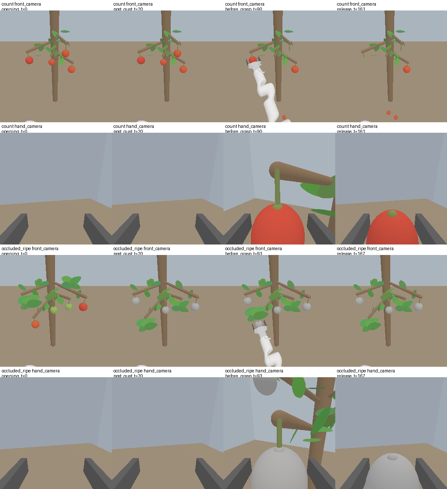

R0阻塞：按§15.6停止，候选任务不能进入训练数据生成。
计数(ii)已审计43/50条，成功27条；即使剩余7条全失败也至少27/50=54%，超过≤30%的门槛。
停止触发于dev245：篮下地面果被缺少高度下界的入篮判定误报，并未真正进入篮内。
双任务专家预览各1条成功，尚未完成各50条专家成功率和裁剪率门槛验证；其余队列未继续。
D5/D6及运行定义未改，未生成训练数据、未训练、未使用新val，不写论文；等待用户审阅。

## 任务语义与实现说明

# 修订7：R0候选语义、审计输入与停止规则

本文件在物理回放前固定。只做任务设计与dev诊断，不生成训练数据、不训练、不写入论文。
D6的机器判定C和原报告原样保留；用户现裁决按B处理，据此重新设计任务。D5确证性结论不改。

## 计数v2语义清单

| 项目 | 候选定义与代码位置 |
|---|---|
| 启用方式 | 新环境`FruitPickTaskV2-v0`显式`task_version='v2'`；默认`v1`走父类行为。原`FruitPick-v1`注册与源码不改。 |
| 布局 | `task_v2_spec.task_layout`复用原布局几何。M为4–6，N重新独立采样于2…M−2，保证总量足够承受2颗风落。此分布是候选v2的一部分，不筛选或重试seed。 |
| 取消自动成功 | 入篮恰好N时仍运行；`task_v2_spec.count_outcome`只在完成信号或预算结束时返回success。 |
| 完成信号 | 物理步30后，连续40步：7个臂关节距原rest均≤0.05rad、臂关节速度绝对值均≤0.05rad/s、两指实际开度均≥0.03m、没有任何果实被双指抓握。前30步不累计完成静止。 |
| 多摘与掉果 | 机器人摘下第N+1颗或入篮>N立即失败；机器人脱果后在篮外跌到z<0.06m立即失败。把“多摘”定义为脱果而非等到多余果入篮，避免预算结束时手持多余果仍算成功。 |
| 预算 | 总1300个物理控制步。完成或预算时，恰好N颗机器人果实入篮且没有机器人掉果才成功；不足N为失败。 |
| 风落 | 每回合私有随机计划选1或2颗；时间均匀取物理步64–96。只选未脱果、不被抓握且距TCP>15cm的树上果实；不足时延后到首次足够的步。选择不用成熟度、N或策略意图。 |
| 风落物理与归属 | 果实转动态并受重力竖直落地，风落ID单独记录；不算机器人摘果或机器人掉果。风落果若进入篮子，标记`wind_basket_anomaly`并停止，不能计为有效成功。 |
| 专家 | 完全沿用v3.1的IK、碰撞几何、tuck/绕行和2步settle。风落使当前目标消失时取消当前技能、重新选择；不改规划器。放第N颗后返回原rest保持至终止。 |
| 事件记忆 | 专家累计自己的放果尝试事件；是否实际入篮由环境最终验证。所有队列另存真实入篮事件，二者不混同。有限信息策略不能读取其中任一历史计数。 |
| 终止实现 | 新环境`task_v2_env.FruitPickTaskV2Env.evaluate`；ManiSkill `sapien_env.py:1052`按`success OR fail`设置terminated，1300步wrapper另设置truncated。 |

### 必须审计的结构性风险

随机吹落1–2颗没有彻底堵住M−R：理想动作下，猜风落数W∈{1,2}并在M−R=N+W时停止，猜中即可成功，歧义只有二元。设计阶段对固定50个新dev种子做CPU逻辑排查，分别报告猜1、猜2的理想化结果；这不是物理审计，更不是专家成功率。
物理审计采用较强的“猜2”基线，且当前可见篮中果实达到N时也可停止。它不接收实际W。该候选很可能达不到≤30%的要求，不能通过削弱脚本来宣称记忆必需。
若实测不通过，按§15.6停下。可供用户随后审阅的替代方向包括采后补回外观相同的果实，或扩大总风落数的歧义；本次都不实施。

## 遮挡v2语义清单

| 项目 | 候选定义与代码位置 |
|---|---|
| 启用方式 | 同一显式v2开关，且task=`occluded_ripe`；原任务默认不改。 |
| 成熟度 | 初始红/绿标签和果实位置保持原任务定义；只改变视觉材质，不改真值成熟度。 |
| 阵风 | 步8–20按smoothstep插值，所有果实的球面及果顶部小球材质均变为同一RGB(0.55,0.55,0.55)；两相机共享世界材质。步20以后不恢复颜色。 |
| 叶簇 | 原阵风和TCP靠近时的抬起行为保留；即使看到果实，也只能看到中性色。隐藏位置仍有先验偏倚，当前帧策略会利用它。 |
| 成功/失败 | 原任务`FruitPickEnv.evaluate`原样：所有成熟果实入篮且没有未成熟入篮即成功；错误入篮或机器人掉果失败。仍在success时终止。 |
| 预算与专家 | 原v3.1运动规划、固定包络v2、物理保持30步、总预算1300；专家使用初始成熟度信息选择目标。 |
| 假设 | 场景记忆：第0帧提供成熟度，预期K0/K4/K8接近；不把叶簇提示误当无信息。这里只记录设计预期，正式协议待R0审阅后另写。 |

## 相机与截图核对

| 阶段 | 计数v2前视/腕视 | 遮挡v2前视/腕视 | 验证方式 |
|---|---|---|---|
| 开头（步0） | 红果；是否看到篮子及内容须实测 | 果实保留成熟色；腕视是否看到树须实测 | 双相机原始PNG、分割像素计数 |
| 阵风后（步20） | 不改颜色；后续风落计划尚未执行 | 所有果实材质已中性，两个相机相同 | PNG与每个果实全部材质RGB检查 |
| 抓取前 | 第一条关闭夹爪命令之前 | 同左，此时不能恢复成熟色 | 双相机原始PNG |
| 放果时 | 第一次张开释放命令后 | 同左 | 双相机原始PNG；全过程篮子/果实可见性日志 |

不预先宣称篮子在所有相机里不可见。任何相机出现篮子（分割像素>0）都记录；可见篮中果实（至少16像素）会作为当前信息提供给捷径脚本。篮子露出但内容不可见与能数清内容分开描述。截图来自真实回放，不用渲染替代图或旧任务图冒充。

## 三类脚本的信息边界与固定策略

所有策略共享冻结v3.1低层抓放技能及碰撞安全几何，低层状态仅维持当前技能，不向选择器传递跨果实的进度计数。信息限制针对每次选果/停止决策，原始真值完整保存在审计端，不能作为隐藏输入传给有限信息选择器。

| 类别 | 提供的信息 | 计数固定策略 | 遮挡固定策略 |
|---|---|---|---|
| (i) current | 当前双相机中≥16像素的果实及几何、可见颜色/叶簇标记、可见篮中果实；计数指令N | 篮中可见数≥N或树上可见果≤1就停止，否则取最左侧可见树果 | 选当前可见红果或带当前可见叶簇标记的果实，优先最左侧 |
| (ii) initial_current | (i)加第0帧上述同口径的信息；没有放果事件或实际风落计数 | 第0帧M减当前R达到N+2或篮中可见数≥N就停止，否则取最左侧树果 | 第0帧成熟标签匹配当前可见树果的位置/ID，优先最左侧；不可见不虚构其当前可摘状态 |
| (iii) history | 完整历史，作为专家上界；允许自己的放果事件及完整真值跟踪 | 放N次后返回rest完成；风落不计入放果次数 | 跟踪初始成熟果实，摘取剩余成熟目标 |

输入日志`decisions.json`逐次记录实际provided字段；(i)的frame0及历史字段必须为空，(ii)的历史字段必须为空。种子、物理步数、风落真值、全局入篮数不传给有限信息策略。稀疏能见度可能使脚本变弱，失败不能证明所有无记忆策略都失败；R0只按用户规定的三种脚本门槛判断。
所有控制动作实际通过固定包络v2；不重新拟合包络。R0没有模型推理，逐控制步执行原专家轨迹，每16条命令记一个执行块，不把轨迹降采样或将一个专家动作重复16次。

## 样本、门槛和停止

每任务每类50个布局，固定dev200–249，seed=4200000+16×episode；不重试、不换seed、不筛规划成功布局。两条专家dev200预览包含在最终各50条里，不额外扩大分母。
先做两任务dev200语义/相机预览，再依次审计：计数(ii)、计数(i)、计数(iii)、遮挡(i)、遮挡(ii)、遮挡(iii)。有限信息队列须≤15/50；要求成功的队列须≥45/50；专家执行步裁剪率严格<0.5%（去掉最初30步，包含完成保持段）。
每队列满50条就作一次判定；首个不达标队列完成后停止，不运行后续队列。任何工程或材质/语义不符立即停止。未跑的指标与截图明确标未验证，不能交付为“R0通过”。

## 划分与R0后权限

新版独立划分登记：`reports/split_registry_fruit_task_v2_20261105.json`。train0–199、dev200–259均计划按v2重新生成；本次只实例化R0的dev200–249诊断布局，不产生训练格式/HDF5。正式val150–199只登记保留，R0不生成或查看；val0–149全部记为已使用并排除。
预期事件记忆计数任务K4/K8优于K0、场景记忆遮挡任务三者接近。以上预测将写入R0之后的新预登记，而不是根据结果调整任务。记忆方法和K0/K4/K8定义不改。
R0审阅之前不生成训练数据、不训练、不修改论文。任何实测不符按§15.6停下，任务定义不自动迭代。

## 实测结果（未完成项明确留空）

| 任务 | 信息限制 | 成功 | 门槛 | 通过 | 包络裁剪步/检查步 | 失败方式 |
|---|---|---:|---|---|---:|---|
| count | current | 0/0 | <=15/50 | None | 0/0 | {} |
| count | initial_current | 27/43 | <=15/50 | None | 40/15598 | {'overpick': 15, 'planning_or_grasp_failure': 1} |
| count | history | 1/1 | >=45/50 | None | 0/311 | {} |
| occluded_ripe | current | 0/0 | <=15/50 | None | 0/0 | {} |
| occluded_ripe | initial_current | 0/0 | >=45/50 | None | 0/0 | {} |
| occluded_ripe | history | 1/1 | >=45/50 | None | 0/257 | {} |

只有满50条才判断队列门槛；专家的裁剪率以去掉开头30步后的执行步为分母，须严格<0.5%。出现失败即停，不追加调参、换seed或重试。

## CPU逻辑排查（不是物理R0审计）

固定50个dev布局，在假设抓放完美且能数清当前树果的理想模型下：猜风落1颗成功18/50，猜2颗成功32/50，仅看剩1颗停止成功19/50。
这些数字不能当作真实专家成功率或R0通过/失败的物理证据，但明确提示二元风落歧义仍可被猜中。本次物理审计在开始前固定更强的猜2基线；不把实际风落数交给它。
逐布局逻辑记录：`/media/fulei/fuleivla/ecm_vla/results/fruit_task_v2_R0_20261105/logical_screen.json`。

## 相机截图与篮子可见性

以下只展示实际物理回放的原始截图；缺失阶段不补画或伪造。每例JSON还保存逐控制步的双相机篮子分割像素计数。

count全部已审计回放的双相机篮子可见性：{'front_camera': {'episodes': 44, 'episodes_with_basket_visible': 0, 'control_frames_with_basket_visible': 0}, 'hand_camera': {'episodes': 44, 'episodes_with_basket_visible': 0, 'control_frames_with_basket_visible': 0}}。

示例：count/dev200，结局finish_signal。按episode升序首个四阶段截图齐全的专家尝试选取，不按成功与否；没有齐全尝试时展示最早尝试的缺图状态。
- front_camera：篮子出现于0个控制帧；首次记录[]。
- hand_camera：篮子出现于0个控制帧；首次记录[]。

opening，物理步0：

post_gust，物理步20：

before_grasp，物理步90：

release，物理步161：

occluded_ripe全部已审计回放的双相机篮子可见性：{'front_camera': {'episodes': 1, 'episodes_with_basket_visible': 0, 'control_frames_with_basket_visible': 0}, 'hand_camera': {'episodes': 1, 'episodes_with_basket_visible': 0, 'control_frames_with_basket_visible': 0}}。

示例：occluded_ripe/dev200，结局success。按episode升序首个四阶段截图齐全的专家尝试选取，不按成功与否；没有齐全尝试时展示最早尝试的缺图状态。
- front_camera：篮子出现于0个控制帧；首次记录[]。
- hand_camera：篮子出现于0个控制帧；首次记录[]。

opening，物理步0：

post_gust，物理步20：

before_grasp，物理步93：

release，物理步167：

## 保全与交付

完整机器摘要：`/media/fulei/fuleivla/ecm_vla/reports/fruit_task_v2_R0_20261105/summary.json`。原始回放、信息输入审计及日志：`/media/fulei/fuleivla/ecm_vla/results/fruit_task_v2_R0_20261105`。
D5/D6结果目录大小、mtime、链接及保护文件sha256与执行前记录一致。划分仅登记；R0不生成train/val示范。
执行状态：`/media/fulei/fuleivla/ecm_vla/results/fruit_task_v2_R0_20261105/status.json`。当前R0_engineering_error；后续须由用户审阅决定。

## 停止后的只读核对与待审阅事项

程序于2026-11-05 04:38 UTC触发停止；当前没有R0回放进程。停止后只读核验、整理截图和写报告，没有修补任务代码、修改判定规则或补跑。

计数ep245在物理步66吹落2、3号果。步89时2号果位于(-0.063404, -0.261192, -0.373730)m；篮底中心高度为0.15m。前8步该果已在地面上滚动，直到XY进入篮子投影才触发标志。父类`FruitPickEnv.in_basket`只检查XY和高度上界，没有篮底下界，故这是篮下误计，不是真实风落入篮。本次没有修补这一错误。

43条已验证计数(ii)回放中27条成功，都是实际风落2颗的布局。输入审计确认选择器只使用第0帧及当前帧，未读取风落真值或放果事件计数；另已核对27条成功的最终果心都在篮底上方，未发现同类地面误计。这里不把27/43当作完整50条的成功率估计，也不做总体推断；但已知成功27条超过整组允许的最多15条，足以确定这版设计无法达到该门槛。

其余7条状态：ep233已产出overpick结果但未经流程审计，不计分；ep245为异常尝试，不计分；ep243/244/248被停止打断；ep241/249未启动。未将它们补成失败或补跑以凑足50条。

两任务dev200专家预览均成功，开头、阵风后、抓取前、放果时的双相机原始截图已保存。遮挡果在阵风后及抓取前均呈中性色。45条已验证回放的全部记录帧中，两相机篮子分割像素均为0；这只描述本次轨迹，不能证明任意可执行姿态都看不到篮子。专家50条成功率与总体裁剪率尚未完成验证。

45条有效回放、149次决策的源文件摘要、信息限制和固定包络执行已独立复核通过；D5/D6目录及保护文件校验不变。逐例证据：`reports/fruit_task_v2_R0_20261105/independent_validation.json`；异常几何、成功下界、未完成布局清单：`reports/fruit_task_v2_R0_20261105/stop_analysis.json`。

依据交接文档§15.6“任何实测与设计说明不符的情况，先停下汇报，不自行改动任务定义”，在此等待审阅。供审阅的两个独立问题是：仅在v2路径补充篮底高度下界；重新设计计数干扰，使总风落数1/2的二元猜测不足以通过。后者可讨论补回果实或扩大扰动种类，但本次均未实现。即使修好入篮判定，也不能据此认为已堵住M−R捷径。
